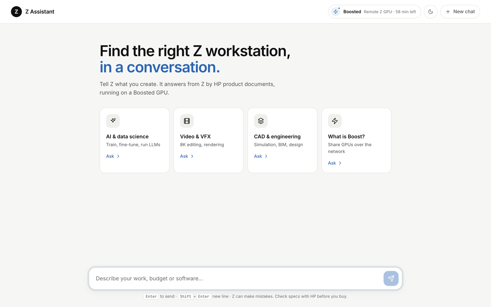
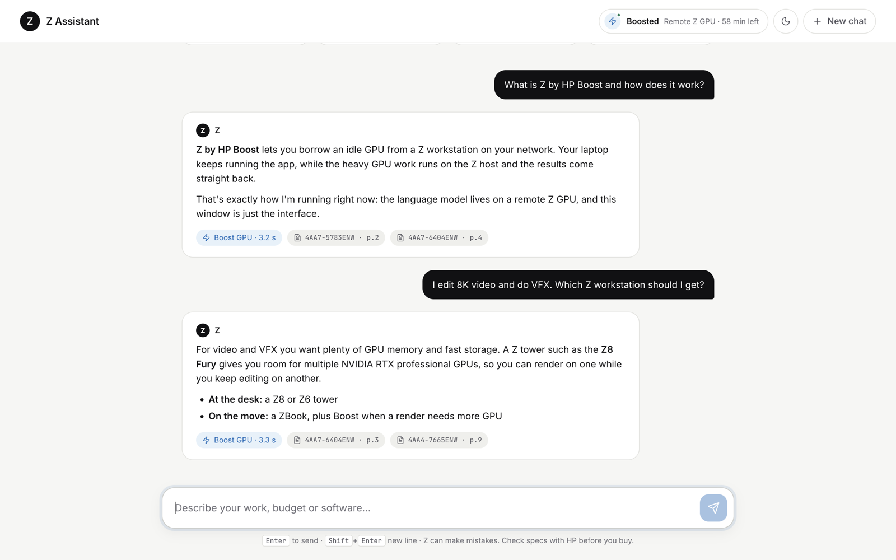
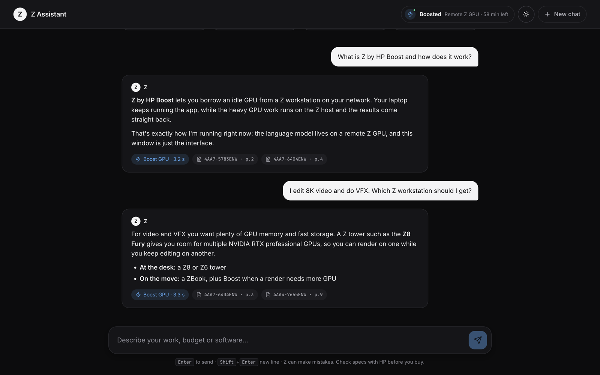
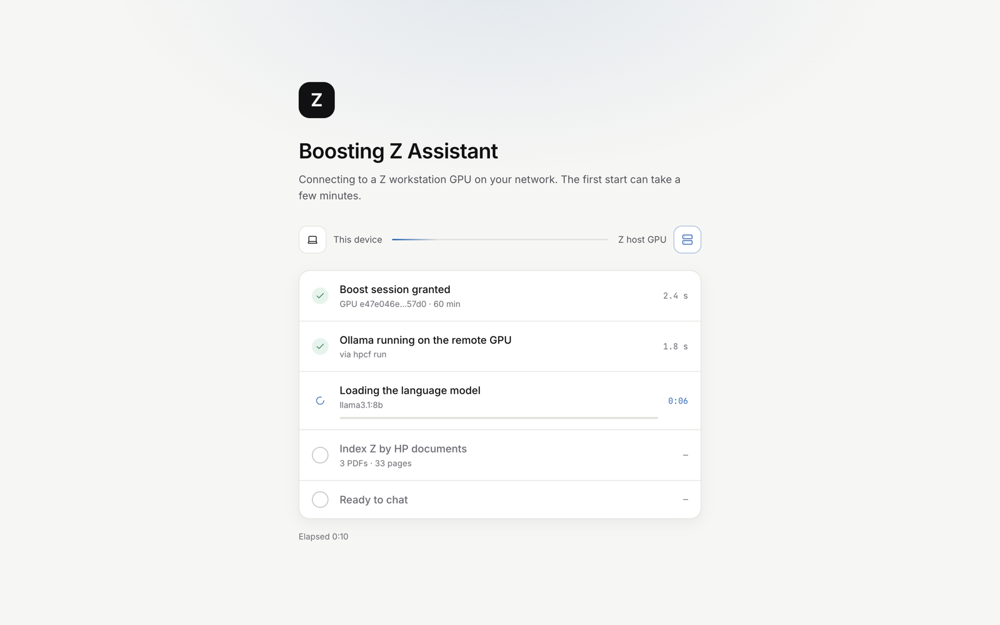
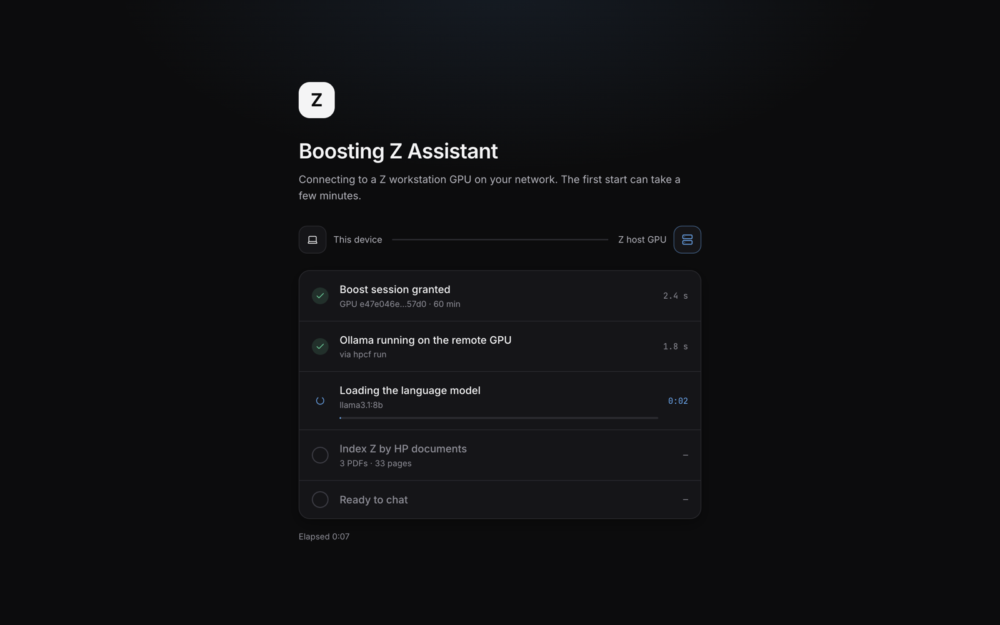
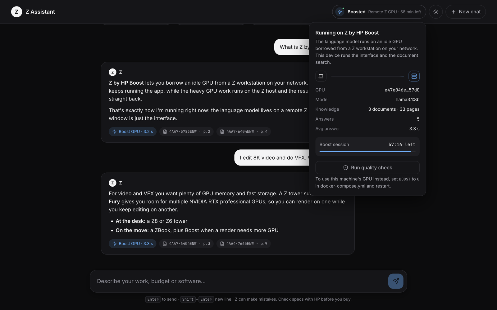
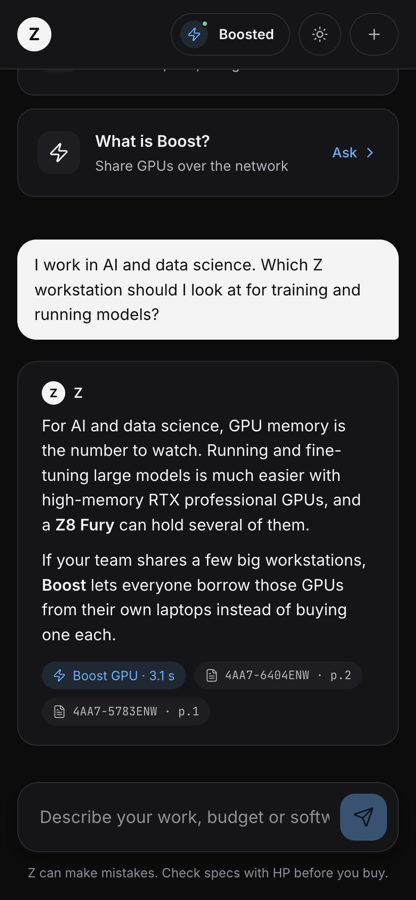

<div align="center">

# Z Assistant

### A conversational guide to Z by HP workstations, powered by a local LLM and Z by HP Boost

Ask Z what you create, and it recommends the right Z workstation from Z by HP product documents.
The model can run on your own GPU, or on an idle GPU borrowed from a Z workstation on your network through **Z by HP Boost**.




</div>

---

## ✨ Features

- **Answers grounded in real documents.** Z searches the Z by HP PDFs in `zhp-info/` and answers from them. Every answer shows the document and page it drew on.
- **Built for Boost.** A startup screen follows every step of connecting to a remote Z GPU. While you chat, a status pill shows whether you're Boosted and how much session time is left.
- **Streaming answers.** Replies appear word by word with formatting, and each one shows which GPU produced it and how long it took.
- **Light and dark themes.** It follows your OS setting until you pick one with the toggle, then remembers your choice.
- **Easy starting points.** One-click questions for AI and data science, video and VFX, CAD and engineering, and "What is Boost?".
- **Answer quality checks.** One click (or `/quality`) scores the conversation with Galileo.
- **Works on any screen.** The layout adapts from desktop to phone, supports keyboard navigation, and respects reduced-motion settings.

## 📸 Screenshots

| Light | Dark |
|:---:|:---:|
|  |  |

### Boost startup

The UI opens straight away and shows each startup step live, with timings: the Boost session, Ollama on the remote GPU, the model loading, and the documents being indexed. If a step fails, it says which one and why.

| Light | Dark |
|:---:|:---:|
|  |  |

### Boost status

Click the **Boosted** pill to see the remote GPU, the model, the knowledge base, answer stats and the time left in the Boost session.

<p align="center">
  
</p>

### Mobile

<p align="center">
  
</p>

<sub>Screenshots are from the built-in demo mode, so the answers, timings and page numbers are sample data.</sub>

## ⚡ How Boost fits in

[Z by HP Boost](https://www.hp.com/us-en/workstations/z-boost.html) lets a device borrow an idle GPU from a Z workstation on the network. Z Assistant uses it to run the language model on that remote GPU:

```text
           This device                                 Z workstation (host)
┌──────────────────────────────────┐   HP Boost   ┌──────────────────────────┐
│ Browser UI  ⇄  server.py         │   GPU fabric │                          │
│                  ⇅ Redis         │  ══════════▶ │  NVIDIA RTX GPU          │
│ zassistant.py (RAG + LLM calls)  │              │  running Ollama +        │
│   └─ run under `hpcf run`        │              │  llama3.1:8b             │
└──────────────────────────────────┘              └──────────────────────────┘
```

With `BOOST=1`, `run.sh` requests a Boost session for `BOOST_GPU_ID`, then starts Ollama and the LLM worker under `hpcf run`, so their GPU work runs on the Z host. With `BOOST=0`, everything runs on the local GPU.

## 🚀 Getting started

### Requirements

- A **Linux** host with **Docker** and **Docker Compose**
- An **NVIDIA GPU**, its driver and the **NVIDIA Container Toolkit** (needed when `BOOST=0`)
- For Boost:
  - The **Z by HP Boost client** installed on this machine. Its `hpcf` tool is expected at `/opt/hpcf/hpcf`.
  - A Z workstation on your network that shares a GPU with you.
- Internet access during the build, to install Ollama, pull `llama3.1:8b` and download the embedding model

### 1. Configure

Edit `docker-compose.yml`:

| Setting | What it does |
|---|---|
| `BOOST` | `'1'` runs the model on a Z host GPU through Boost. `'0'` uses the local GPU. |
| `BOOST_GPU_ID` | ID of the shared Z host GPU to request |
| `BOOST_SESSION_TIMEOUT` | *(optional)* Boost session length in seconds. The default is `3600`. |
| `PORT` | Port for the web UI. The default is `8080`. |
| `HOST` | *(optional)* Address the UI listens on. The default is `127.0.0.1`; use `0.0.0.0` to open it to your network. |
| volumes | Replace `/home/kn1ght/.config/HP Compute Fabric` with **your** Boost client config folder |

### 2. Prompt-quality scoring (optional)

To score answers with Galileo, create `core/keys.py` (it's gitignored):

```python
GALILEO_API_KEY = "your-key"
```

Without a key the assistant still works, and the quality check tells you it isn't set up.

### 3. Run

```sh
docker compose up --build --remove-orphans
```

Open **http://localhost:8080**. The startup screen shows progress. A Boosted start can take a few minutes the first time, while the model loads onto the remote GPU.

## 💬 Using it

- Type a question, or click a starting point. Press <kbd>Enter</kbd> to send and <kbd>Shift</kbd>+<kbd>Enter</kbd> for a new line. <kbd>/</kbd> jumps to the input box.
- While an answer is streaming, the send button turns into **Stop**.
- **New chat** starts over and clears Z's memory of the conversation.
- **Run quality check** in the Boost popover, or the `/quality` command, sends the conversation to Galileo for scoring (`/promptquality` also works). `/new` starts a new chat.
- The sun and moon button switches between light and dark themes.

## 🎨 Try the UI without a GPU

`server.py` has a **demo mode** that simulates a Boost startup and streams sample answers. It doesn't need a GPU, Ollama, Redis or Docker:

```sh
python3 -m venv .venv
.venv/bin/pip install flask redis
.venv/bin/python server.py --demo
```

Open http://127.0.0.1:8080. Useful extras:

- Open `http://127.0.0.1:8080/?boot` to replay the Boost startup screen.
- Open `http://127.0.0.1:8080/?boot=local` to see the local-GPU version.
- `--demo-mode local` starts the demo in local-GPU mode, and `--boot-seconds 20` makes the simulated startup slower.

## 🏗️ How it works

```text
browser ── HTTP + SSE ──▶ server.py ──┐
                                      │   Redis
run.sh (Boost, Ollama) ── progress ──▶├── z:status    startup steps, session, answer stats
zassistant.py (LLM worker) ◀─────────▶├── z:jobs      chat / reset / quality jobs
                                      └── z:stream:*  answer tokens, sources, timing
```

1. **`run.sh`** starts Redis and the web UI first, so the browser can follow startup. Then it requests the Boost session (if `BOOST=1`), starts Ollama and launches the worker, reporting each step to Redis.
2. **`zassistant.py`** loads `llama3.1:8b` into GPU memory and indexes the PDFs in `zhp-info/` (HuggingFace embeddings on CPU, stored in Chroma). It then takes jobs from Redis and streams back the source pages, answer tokens and timing.
3. **`server.py`** serves the UI from `web/` and connects the browser to Redis. It never loads a model itself, so the UI stays responsive while the model is busy.

### API

| Endpoint | Description |
|---|---|
| `GET /api/status` | Startup steps, Boost or local mode, GPU, session, knowledge base, answer stats |
| `POST /api/chat` | `{"text": "..."}` → `text/event-stream` of `sources`, `token`, `done` or `error` events |
| `POST /api/reset` | Clear the conversation memory |
| `POST /api/quality` | Run the Galileo prompt-quality check |

### Project layout

```text
zassistant/
├── server.py              # Web server: UI, API, demo mode
├── zassistant.py          # LLM worker: model warm-up, RAG, job loop
├── run.sh                 # Container entrypoint: Redis, UI, Boost session, Ollama, worker
├── core/
│   ├── llama_rag.py       # Ollama + history-aware RAG chain, streaming, Galileo
│   ├── rag.py             # PDF loading, chunking, embeddings, Chroma retriever
│   └── status.py          # Startup and status reporting to Redis
├── web/                   # Browser UI (HTML, CSS, JS, icons, bundled fonts)
├── zhp-info/              # Z by HP product documents (the knowledge base)
├── docker/zassistant/     # Dockerfile (CUDA 12.4, Ollama, llama3.1:8b baked in)
└── docs/screenshots/      # Images used in this README
```

## 🙏 Credits

- Fonts: [Inter](https://rsms.me/inter/) and [JetBrains Mono](https://www.jetbrains.com/lp/mono/), under the SIL Open Font License, bundled in `web/fonts`.
- Icons: [Lucide](https://lucide.dev), under the ISC license.
- Model: [Llama 3.1](https://ai.meta.com/llama/), served by [Ollama](https://ollama.com).

## 📜 License

[Apache 2.0](LICENSE)
